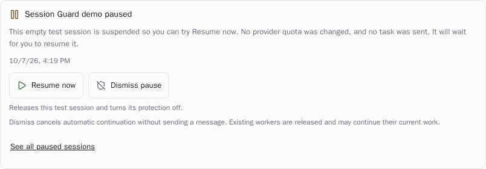

# paseo-session-guard

[](https://paseo.sh)
[](https://github.com/tomgrin10/paseo-session-guard/actions/workflows/ci.yml)
[](LICENSE)

Pause agents at their provider's session limit and continue the same conversations after reset, even when the Paseo app is closed.



Native pause demo in Paseo; no provider quota was changed.

## Install

Requires [Paseo](https://paseo.sh) **0.10.1 or newer**. Enable plugins in **Settings → Plugins**, then run on each host:

```sh
paseo plugin install https://github.com/tomgrin10/paseo-session-guard.git
```

Update with `paseo plugin update paseo-session-guard`.

## Use

Protection is on for all sessions by default, with automatic continuation after reset.

- Open the **Session Guard** composer pill to opt a session out or restore protection.
- Open **Paused sessions** in the sidebar to see waiting work, reset times, and sessions needing attention. Paused workspaces get an amber **Paused** label.
- Use **Resume now** on a pause's timeline card to continue immediately, or **Dismiss pause** to cancel its scheduled continuation and release suspended workers. Both opt that session out until you restore protection.
- In **Settings → Plugins → Session Guard**, change the host default, pause threshold, automatic continuation, and native subagent coverage. Settings and the overview also open from **⌘K / Ctrl+K**.

## How it works

By default, Session Guard checks every 15 seconds and pauses at **100%** session usage. It resumes after a fresh usage report confirms capacity is available, plus a **30-second** grace period. Paseo caches provider reports, so detection follows its upstream refresh timing.

On **Linux**, Claude and Codex processes and their native subagents pause and resume together in place. This requires `/proc` access and verified local process ownership. On other hosts, turn **Include native subagents** off to use foreground interruption followed by one continuation message. Other providers use this mode when they report a supported session window.

Saved pauses survive plugin and daemon restarts; a full restart continues the parent conversation after reset, but cannot preserve live subagent processes. New user messages, explicit stops, and session opt-outs cancel automatic recovery. Already-sent requests cannot be undone, and paused tools may time out or hold locks.

Paseo plugins run trusted, unsandboxed code. Session Guard uses Paseo's usage reports and stores pause state under `$PASEO_HOME/plugin-data/session-guard/`. It has no runtime dependencies.

See the [behavior guide](docs/behavior.md) for settings, authentication, recovery, and platform limits.

## Development

```sh
npm ci
npm run verify
npm pack --dry-run
```

Checks cover quota/reset handling, persistence, synthetic Linux process trees, compilation without runtime dependencies, and cleanup. Reload only this plugin with `paseo plugin reload paseo-session-guard`; keep your daemon running.

## More Paseo plugins

- [Defer](https://github.com/tomgrin10/paseo-defer) — Schedule messages for later delivery.
- [Graphite](https://github.com/tomgrin10/paseo-graphite) — Graphite stacks and PR status.
- [Smart Session](https://github.com/tomgrin10/paseo-smart-session) — Context compaction and usage insights.
- [Vitals](https://github.com/tomgrin10/paseo-vitals) — Host, agent, and Docker health.
- [Send to Paseo](https://github.com/tomgrin10/send-to-paseo) — Send PRs to Paseo from Chrome.

## License

[MIT](LICENSE) © 2026 Tom Gringauz. Daemon connection and reset-window handling adapted from [Defer](https://github.com/tomgrin10/paseo-defer).
